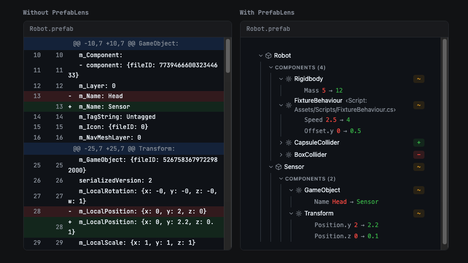
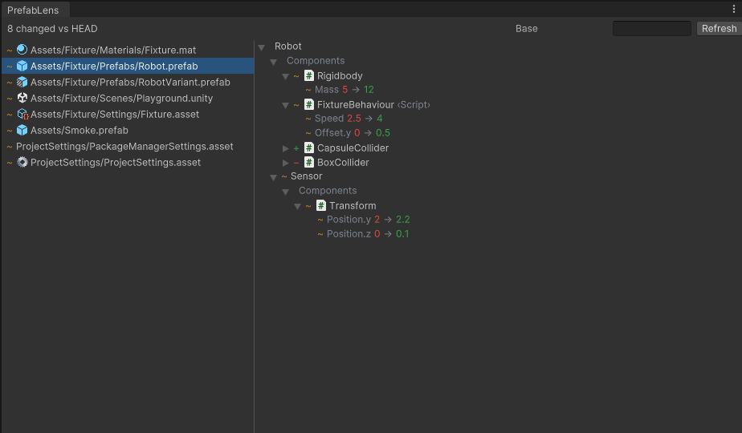
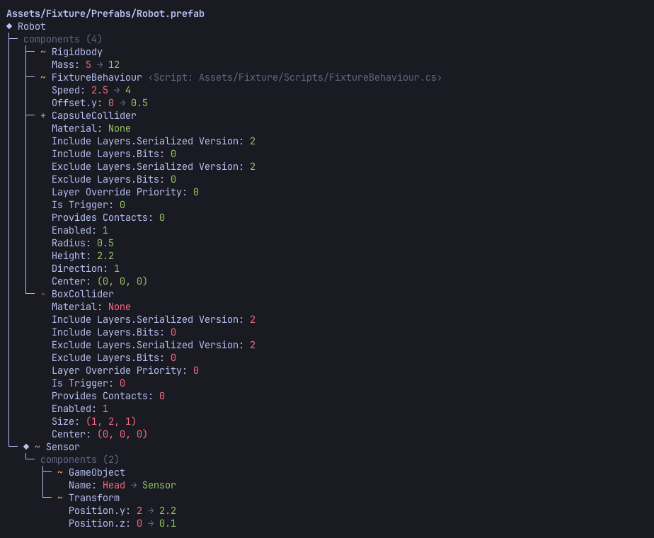

# PrefabLens

[](https://ziglang.org)
[](LICENSE)
[](https://github.com/hashiiiii/PrefabLens/releases/latest)
[](https://github.com/hashiiiii/PrefabLens/actions/workflows/ci.yml)

PrefabLens shows changes to GameObjects, components, and fields in UnityYAML assets.  
Review diffs in GitHub pull requests, the Unity Editor, or the terminal.  
Use the CLI to merge conflicting assets.

Try the [live demo](https://prefablens.hashiiiii.workers.dev/).

| Use case | Install | Guide |
| --- | --- | --- |
| Review a GitHub pull request | [Chrome extension](#chrome-extension) | [Authentication, supported files, and development](docs/extension.md) |
| Review changes in a Unity project | [Unity Editor package](#unity-editor) | [CLI setup, window controls, and development](docs/editor.md) |
| Compare or merge assets locally | [CLI](#cli) | [Commands, merge behavior, and key bindings](docs/cli.md) |
| Review semantic diffs with `git diff` | [CLI](#cli) + [Lantana](https://github.com/hashiiiii/Lantana#installation) | [Git diff integration](#use-with-git-diff) |

Assets must use Unity's text serialization format.  
Binary assets do not produce semantic diffs.  
In Unity's Editor settings, set **Asset Serialization > Mode** to **Force Text** for text serialization.

## Chrome extension

Install from the [Chrome Web Store](https://chromewebstore.google.com/detail/dlhnalbfkikchkfedfneiimadommcnip), then open a pull request's **Files changed** page on `github.com`.  
Select **Semantic** in the PrefabLens control.  
If prompted, sign in through the panel to give the extension GitHub API access.

<p align="center">
  
</p>

See the [extension guide](docs/extension.md) for authentication, privacy, and troubleshooting.

## Unity Editor

Requires Unity **2022.3 or later**.

Install with OpenUPM:

```bash
openupm add com.hashiiiii.prefablens
```

For scoped registry setup, see the [OpenUPM package page](https://openupm.com/packages/com.hashiiiii.prefablens/).

Alternatively, open **Window > Package Manager**, choose **Add package from git URL**, and enter:

```text
https://github.com/hashiiiii/PrefabLens.git?path=editor#v0.12.0
```

Open **Window > PrefabLens**.  
The package downloads the CLI automatically when needed, so the first download requires internet access.  
To use an installed executable, select it in **Preferences > PrefabLens**.  
Select a changed asset in the left pane to view its semantic diff.  
**Base** selects the Git revision to compare with the working tree; an empty value uses `HEAD`.

<p align="center">
  
</p>

See the [Editor guide](docs/editor.md) for CLI settings and troubleshooting.

## CLI

### Install

Homebrew on macOS or Linux:

```bash
brew install hashiiiii/tap/prefablens
```

Scoop on Windows:

```bash
scoop bucket add hashiiiii https://github.com/hashiiiii/scoop-bucket
scoop install prefablens
```

With mise:

```bash
mise use -g github:hashiiiii/PrefabLens@latest
```

For manual installation, download your platform's ZIP from the [latest GitHub Release](https://github.com/hashiiiii/PrefabLens/releases/latest).  
Extract it and add its directory to `PATH`.  
Each archive contains the native `prefablens` executable and the `git-merge-prefablens` script; keep them together for Git merge integration.

### Compare assets

Run Git comparisons from your repository:

```bash
prefablens                              # HEAD vs working tree, all changed UnityYAML files
prefablens Assets/Foo.prefab            # HEAD vs working tree, one file
prefablens main                         # main vs working tree
prefablens HEAD~1 HEAD Assets/Foo.prefab  # two revisions, one file
prefablens --open main                  # open an HTML report in your browser
```

Compare two files without Git, or produce JSON for another tool:

```bash
prefablens before.prefab after.prefab
prefablens --json before.prefab after.prefab
```

<p align="center">
  
</p>

### Use with git diff

To view semantic UnityYAML changes through `git diff`, install [Lantana](https://github.com/hashiiiii/Lantana#installation) alongside the PrefabLens CLI.  
Follow Lantana's [PrefabLens renderer setup](https://github.com/hashiiiii/Lantana#example-prefablens) to configure `renderers.json`, then run these commands in your repository:

```bash
lantana set
git diff
git diff --cached
```

Lantana uses PrefabLens for matching UnityYAML files and shows raw Git diffs for other files.  
`lantana set` configures the diff pager for the current clone; use `lantana unset` in that clone to remove it.

For a single comparison without changing Git configuration, use:

```bash
git diff | lantana
```

### Merge with Git

Merge integration requires Git **2.45 or later**.  
Run setup in your repository:

```bash
prefablens setup-merge
git merge origin/main
```

The command registers the UnityYAML merge driver and merge tool for the current clone.  
The driver merges compatible content changes automatically.  
Resolve remaining conflicts with `git mergetool --tool=prefablens`.

Choose a different scope when needed:

| Command | Attribute rules | Git configuration |
| --- | --- | --- |
| `prefablens setup-merge --local` (default) | `.git/info/attributes` | Current clone |
| `prefablens setup-merge --project` | `.gitattributes` | Current clone |
| `prefablens setup-merge --user` | User attributes file | Global |

Commit `.gitattributes` when using `--project`.  
Each clone still needs the Git configuration from setup.

For repository-wide dependency validation and interactive resolution of content and structural conflicts, select the full merge strategy:

```bash
prefablens setup-merge --local
git config --local --replace-all pull.twohead prefablens
git merge origin/main
```

`pull.twohead` selects PrefabLens as the default strategy.  
This setting also affects pull, rebase, and cherry-pick.  
You can also select the strategy explicitly for one merge with `git merge -s prefablens origin/main`.  
See [merge behavior](docs/cli.md#merge-behavior) for operation-specific details and inherited Git settings.

https://github.com/user-attachments/assets/2ad6a2e9-5562-40b8-ab7e-c5f277da3d8b

### Use a GUI merge tool

On macOS or Windows, select the installed PrefabLens executable as your Git client's external merge tool and use these arguments:

```text
mergetool --terminal <base> <local> <remote> <merged>
```

Replace the four paths with your client's placeholders, quoting each path if the client requires it.  
Open a conflicted file with the tool, complete the resolution in PrefabLens, then stage the result in your Git client.

[Fork](https://fork.dev/) example:

https://github.com/user-attachments/assets/d6dd0038-498f-42f3-8447-77a6e597ddf2

### Customize key bindings

```bash
prefablens setup-keymap
```

Edit the file at the printed path, then reopen the merge tool.  
See [key bindings](docs/cli.md#key-bindings) for contexts, actions, and examples.

## Contribute

Read [CONTRIBUTING.md](CONTRIBUTING.md) for the issue approval process, toolchain setup, build commands, and checks.  
Use the [CLI](docs/cli.md), [extension](docs/extension.md), and [Editor](docs/editor.md) guides for component-specific behavior and code structure.

## License

[Apache License 2.0](LICENSE).  
See [third-party notices](THIRD_PARTY_NOTICES.md) for dependency licenses.
