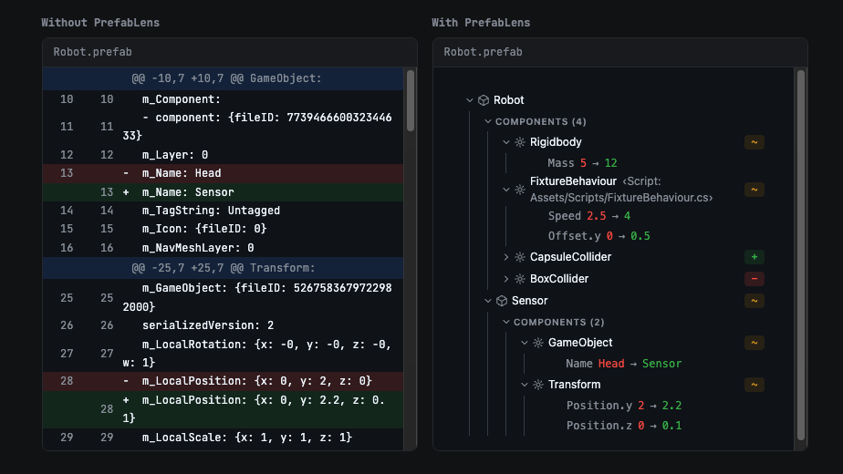
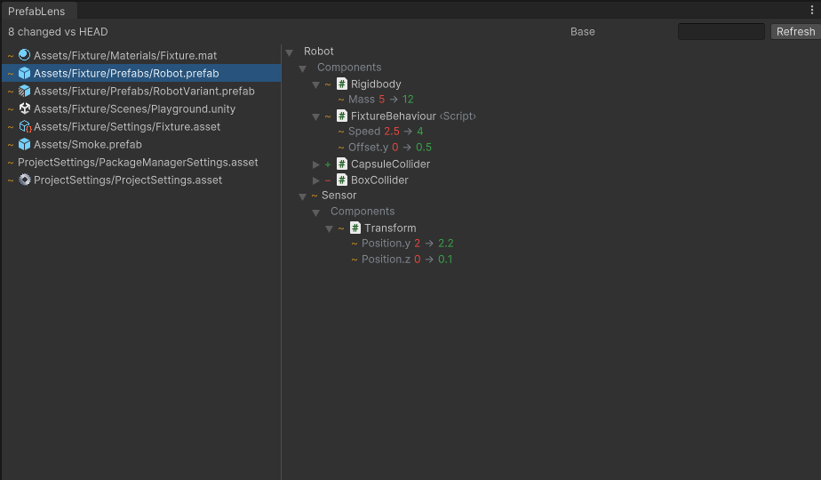
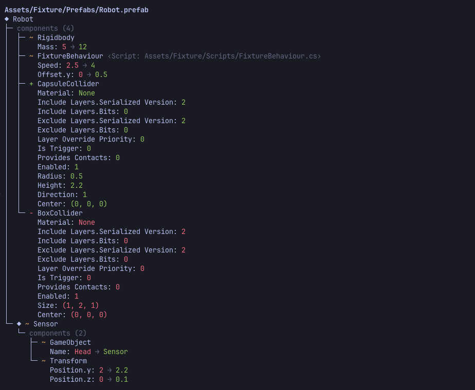

# PrefabLens

[](LICENSE)
[](https://github.com/hashiiiii/PrefabLens/releases)
[](https://github.com/hashiiiii/PrefabLens/actions/workflows/ci.yml)

PrefabLens shows semantic diffs and merges for UnityYAML assets, including changes to GameObjects, components, and fields.

Use the [Chrome extension](#chrome-extension), [Unity Editor package](#unity-editor), or [CLI](#cli).
Try the [live demo](https://prefablens.hashiiiii.workers.dev/).

## Chrome extension

The extension shows semantic diffs in GitHub pull requests, only on `github.com`.

<p align="center">
  
</p>

Install the extension from the [Chrome Web Store](https://chromewebstore.google.com/detail/dlhnalbfkikchkfedfneiimadommcnip).

## Unity Editor

<p align="center">
  
</p>

> [!IMPORTANT]
> The package requires Unity **2022.3 or later**.

### Installation

#### OpenUPM

```bash
openupm add com.hashiiiii.prefablens
```

For scoped registry installation without [openupm-cli](https://github.com/openupm/openupm-cli), see the [package page](https://openupm.com/packages/com.hashiiiii.prefablens/).

#### UPM

1. Open `Window > Package Manager` in Unity.
2. Click + in the top left corner, then select `Add package from git URL....`
3. Enter `https://github.com/hashiiiii/PrefabLens.git?path=editor`.
4. Click Add.

See the [Unity manual](https://docs.unity3d.com/6000.6/Documentation/Manual/upm-ui-giturl.html) for details.

### Usage

Open `Window > PrefabLens`.

The left pane lists UnityYAML assets changed from **Base**, or **HEAD** when **Base** is empty.
Select an asset to view its semantic diff on the right.

## CLI

<p align="center">
  
</p>

### Installation

#### Homebrew (macOS / Linux)

```bash
brew install hashiiiii/tap/prefablens
```

#### Scoop (Windows)

```bash
scoop bucket add hashiiiii https://github.com/hashiiiii/scoop-bucket
scoop install prefablens
```

#### mise

```bash
mise use -g github:hashiiiii/PrefabLens
```

#### Manual

Download your platform's ZIP from [GitHub Releases](https://github.com/hashiiiii/PrefabLens/releases).
Each archive contains one native `prefablens` executable and the `git-merge-prefablens` script.

### Usage

#### Diff

```bash
prefablens                              # HEAD vs working tree, all changed UnityYAML files
prefablens Assets/Foo.prefab            # HEAD vs working tree, one file
prefablens main                         # ref vs working tree, all changed UnityYAML files
prefablens HEAD~1 HEAD Assets/Foo.prefab  # ref vs ref, one file
prefablens before.prefab after.prefab   # plain comparison of two files

prefablens --json before.prefab after.prefab
prefablens --open main                  # write the report to a temp file and open it
```

#### Merge

> [!IMPORTANT]
> PrefabLens uses Git **2.39 or later** to resolve UnityYAML conflicts during `git merge`.

Choose a setup scope:

| Command                            | Attributes             | Git configuration |
| ---------------------------------- | ---------------------- | ----------------- |
| `prefablens setup-merge --project` | `.gitattributes`       | Current clone     |
| `prefablens setup-merge --local`   | `.git/info/attributes` | Current clone     |
| `prefablens setup-merge --user`    | User attributes file   | Global            |

> [!NOTE]
> `prefablens setup-merge` defaults to `--local`.

Use the normal merge command:

```bash
git merge origin/main
```

https://github.com/user-attachments/assets/2ad6a2e9-5562-40b8-ab7e-c5f277da3d8b

Set the installed PrefabLens executable as your GUI client's external merge tool on macOS or Windows.
Use these arguments:

```text
mergetool --terminal <base> <local> <remote> <merged>
```

Replace the four paths with your client's placeholders.
Open a conflicted file with the tool, resolve it in PrefabLens, then stage it in your Git client.

[Fork](https://fork.dev/) example:

https://github.com/user-attachments/assets/d6dd0038-498f-42f3-8447-77a6e597ddf2

#### Key bindings

Create an editable keymap after installing the CLI:

```bash
prefablens setup-keymap
```

The command prints the file path and preserves existing files.
Edit that file, then reopen the merge tool to apply changes.

| Environment | Path |
| --- | --- |
| Nonempty `XDG_CONFIG_HOME` | `$XDG_CONFIG_HOME/prefablens/keymap.json` |
| Windows | `%APPDATA%\prefablens\keymap.json` |
| macOS / Linux | `~/.config/prefablens/keymap.json` |

Edit entries in the generated file, such as these two shortcuts:

```json
{
  "merge": { "toggle_raw_view": ["Ctrl+r"] },
  "editor": { "submit": ["Ctrl+x Ctrl+Enter"] }
}
```

Keep the other entries to retain their shortcuts. Omitted actions and `[]` are unbound.
A missing file uses the embedded initial keymap.
Separate sequence steps with spaces: `Ctrl+x Ctrl+Enter` means Ctrl+X, then Ctrl+Enter.
See [available actions](docs/cli.md#key-bindings) and the [initial keymap](cli/src/keymap.json).

## Development

Install [mise](https://mise.jdx.dev/), then install the toolchain from the repository root:

```bash
mise install
```

### Folder structure

| Directory    | Description                                                        |
| ------------ | ------------------------------------------------------------------ |
| `core/`      | Zig semantic diff engine for the CLI and WASM                      |
| `cli/`       | Native `prefablens` CLI                                            |
| `extension/` | Chrome extension for semantic GitHub pull request diffs            |
| `editor/`    | Unity Editor package for semantic diffs                            |
| `site/`      | Live demo on Cloudflare Workers using CLI and extension artifacts   |

### Build and test

Run these commands from the repository root.

#### Core and CLI

```bash
zig build
zig build wasm
zig build test
```

`zig build` installs the CLI and Git strategy script to `zig-out/bin/`.
`zig build wasm` compiles `core/` to WASM for the extension and site.
`zig build test` runs native core and CLI tests.

#### Chrome extension

Build and test commands run `zig build wasm` when needed.

```bash
(cd extension && pnpm install && pnpm run build && pnpm test)
```

#### Unity Editor

These .NET tests call the native CLI and run without Unity.

```bash
zig build test-installation-binaries -Doptimize=ReleaseSafe
PREFABLENS_TEST_BIN_DIR="$PWD/zig-out/bin" \
PREFABLENS_TEST_ALT_BIN_DIR="$PWD/zig-out/test-alternate-bin" \
  dotnet test editor/DotNetTests~/Tests
```

#### Site

The site build needs the CLI, the WASM module, and the extension demo bundle.

```bash
zig build
zig build wasm
(cd extension && pnpm install && pnpm run demo)
(cd site && pnpm install && pnpm test && pnpm run build)
```

### Further reading

- [CLI](docs/cli.md)
- [Chrome extension](docs/extension.md)
- [Unity Editor package](docs/editor.md)

## Contributing

Open an issue first and wait for its `approved` label before submitting a pull request.
Read [CONTRIBUTING.md](CONTRIBUTING.md).

## License

[Apache License 2.0](LICENSE)
