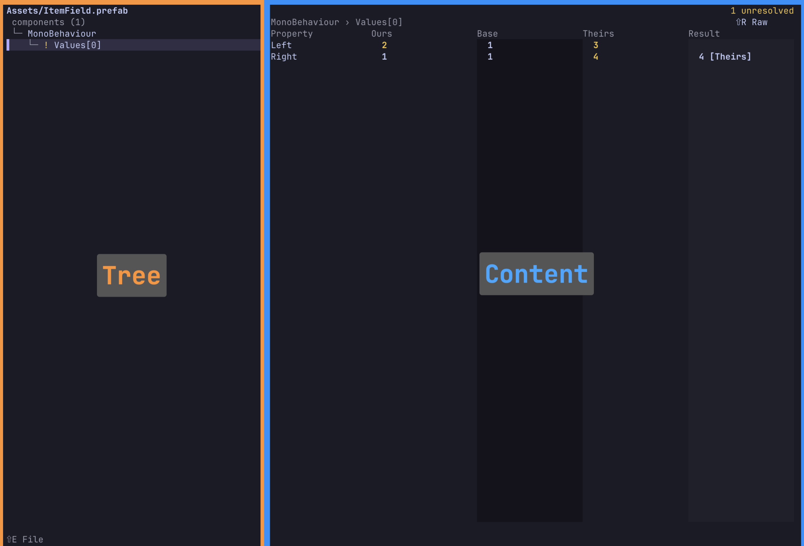
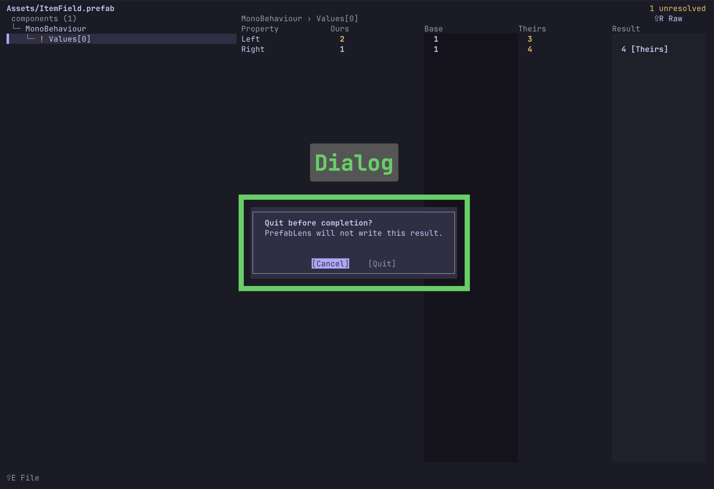

# CLI

`prefablens` compares text-serialized Unity assets and shows changes to GameObjects, components, and fields.  
Its tree output shows semantic changes rather than raw YAML line diffs.

This guide covers CLI commands, Git merge integration, merge-tool controls, and the CLI source boundary.  
For installation and everyday workflows, see the [README](../README.md).  
For contributor workflows and checks, see [CONTRIBUTING.md](../CONTRIBUTING.md).

## Diff command

With no operands, `prefablens` compares `HEAD` with the working tree and shows all changed UnityYAML files:

```sh
prefablens
prefablens Assets/Player.prefab
prefablens main
prefablens v0.6.0 v0.7.0
prefablens HEAD~1 HEAD Assets/Boss.unity
prefablens before.prefab after.prefab
prefablens --json main | jq '.[].path'
prefablens --project Game Game/Assets/Foo.prefab
prefablens --open main
```

In Git mode, bulk mode includes changed tracked files and excludes untracked files.  
An explicit path is compared even if its content is not UnityYAML; binary-serialized assets produce an empty diff.  
Bulk mode also checks content and skips binary candidates.

### Operands

An operand ending in a supported UnityYAML extension, case-insensitively, is a path.  
Any other operand is a Git ref.  
Flags can appear between operands.

| Operands | Comparison |
|---|---|
| (none) | `HEAD` vs the working tree, all changed UnityYAML files |
| `<path>` | `HEAD` vs the working tree, one file |
| `<ref>` | Ref vs the working tree, all changed UnityYAML files |
| `<ref> <path>` | Ref vs the working tree, one file |
| `<ref> <ref>` | First ref vs second ref, all changed UnityYAML files |
| `<ref> <ref> <path>` | First ref vs second ref, one file |
| `<before> <after>` (two paths) | Compare two files without Git |

More than two refs, more than two paths, or a ref with two paths is an error (exit 2).  
In Git mode, paths are relative to the repository root, including when you run the command from a subdirectory or use `--project`.

Supported extensions are `.prefab`, `.unity`, `.asset`, `.mat`, `.anim`, `.controller`, `.overrideController`, `.physicMaterial`, `.physicsMaterial2D`, `.playable`, `.mask`, `.brush`, `.flare`, `.fontsettings`, `.guiskin`, `.giparams`, `.renderTexture`, `.spriteatlas`, `.spriteatlasv2`, `.terrainlayer`, `.mixer`, `.shadervariants`, `.preset`, `.signal`, `.lighting`, and `.scenetemplate`.

### Options and output

| Flag | Effect |
|---|---|
| `--json` | Emit `prefablens.diff.v2`: one diff object for a single file, or a `[{path, diff}]` array in bulk mode. An empty bulk result is `[]`. Successful runs write JSON only. |
| `--html` | Write a self-contained HTML report to standard output. |
| `--open` | Write an HTML report to a temporary file, print its path, and open it in a browser. Conflicts with `--json`. |
| `--project DIR` | Set the Unity project root for GUID resolution and source prefabs. Git uses the repository containing `DIR`. An unreadable directory is an error (exit 1). |
| `--no-project` | Skip the default GUID scan. Conflicts with `--project`. |
| `--color` | Force ANSI colors when standard output is redirected. |
| `--no-color` | Disable ANSI colors, overriding automatic detection and `--color`. |
| `--version` | Print `prefablens X.Y.Z` and exit 0. |
| `-h`, `--help` | Print usage and exit 0. |

The default output is a semantic tree.  
Colors are enabled when standard output is a terminal; use `--color` to force them when output is redirected or `--no-color` to disable them.

`--open` uses the first nonempty value of `TMPDIR` and `TEMP`, or `/tmp` if neither is set.  
The report name is `prefablens-<stem>-<millis>.html`.  
If the report is written but the browser cannot open, the CLI prints a warning and exits 0.

### GUID resolution

Unity references contain `fileID`, `guid`, and `type`. The CLI resolves GUID values as follows:

- `--project DIR` scans `.meta` files under `DIR` before diffing.
- In Git mode, the default scans `Assets/` and `Packages/` under the repository root only when a diff has unresolved references.  
  Built-in engine references resolve by name and do not trigger a scan.
- `--no-project` disables that default scan.

A failed or empty default scan leaves references unresolved.  
Tree and HTML output show them as `guid:<hex>`; JSON lists them in `unresolvedGuids`.

### Errors and limits

| Exit code | Meaning |
|---|---|
| 0 | Success, including a bulk diff with no UnityYAML changes |
| 1 | Runtime error, such as a Git failure or timeout, a file read failure, an unreadable project directory, input nested too deeply, or a failed HTML report write |
| 2 | Usage error, such as an unknown flag, conflicting flags, too many operands, or no value after `--project` |

Expected runtime errors print one line to standard error. An uncaught Zig trace indicates an internal error.

Input files are limited to 64 mebibytes each. Git subprocesses time out after 60 seconds. A timeout returns exit 1.

## Git merge integration

Merge setup and the full strategy require Git 2.45 or later.  
Git must find the installed `prefablens` executable on `PATH`.  
The full strategy also requires the packaged `git-merge-prefablens` script on `PATH`, outside the directory printed by `git --exec-path`.

Before writing attributes or Git configuration, the CLI checks that Git can run the installed file driver.  
With `--strategy`, it also checks the strategy helper.  
Both commands must report the installed CLI version.

### Configuration

```text
prefablens setup-merge [--project|--local|--user] [--strategy]
```

Choose at most one scope. The default is `--local`.

| Scope | Attribute rules | Git configuration |
|---|---|---|
| `--project` | Repository-root `.gitattributes` | Local |
| `--local` or no scope flag | Git's `info/attributes` file, usually `.git/info/attributes` | Local |
| `--user` | User attributes file | Global |

`--project` writes shareable rules to `.gitattributes`; commit that file to share the rules.  
Merge-driver and merge-tool settings remain local to each clone unless user configuration already provides them.

Project and local configuration require a Git working tree and work from its subdirectories.  
Local configuration asks Git for the attributes path, so linked worktrees use the correct file.  
Outside a working tree, these scopes exit 2 without writing configuration files.  
Use `prefablens setup-merge --user` for user-wide configuration.

User-wide configuration works from any directory.  
It uses the global `core.attributesFile` value, including values from included configuration.  
Git expands `~`.  
The path must be absolute or start with `~/`; empty and relative paths are rejected.  
If unset, the command uses `$XDG_CONFIG_HOME/git/attributes`, or `~/.config/git/attributes` when `XDG_CONFIG_HOME` is unset or empty, and registers that path in global configuration.  
Existing rules are preserved, repeated configuration does not duplicate them, and a symlink is preserved while its target is updated.

Git checks attributes in this order: `info/attributes`, repository `.gitattributes`, then the user attributes file.  
See [Git attributes](https://git-scm.com/docs/gitattributes) for the complete rules.

### Merge behavior

Without a custom strategy, Git uses its native `ort` strategy by default.  
The configured attributes select the PrefabLens file driver for UnityYAML paths; other formats use Git's normal merge behavior.  
`git revert` uses Git's internal strategy, while the file driver and merge tool still apply.

To select the full strategy for this clone, add `--strategy` to `prefablens setup-merge`.  
This writes `pull.twohead=prefablens` in the selected Git configuration scope, replacing duplicate values there.  
Without `--strategy`, the command leaves existing `pull.twohead` values unchanged and adds none when absent.

The equivalent local Git command is:

```sh
git config --local --replace-all pull.twohead prefablens
```

`--replace-all` replaces duplicate entries with a single value. Without it, Git refuses to replace multiple entries.

Git reads `pull.twohead` for `merge`, `pull`, `rebase`, and `cherry-pick`.  
For rebase and cherry-pick, Git uses the first configured value, so an earlier system or global value can take precedence over a local opt-in.  
Inspect all values and their origins with:

```sh
git config --show-origin --show-scope --get-all pull.twohead
```

To use the full strategy for one operation, select it explicitly:

```sh
git merge -s prefablens origin/main
git rebase -s prefablens origin/main
git cherry-pick --strategy=prefablens <commit>
```

The full strategy checks the installed CLI before it writes merge objects, the index, or working files.  
It prepares the index and working tree from Git's merge result, then opens the interactive resolver only for UnityYAML conflicts.  
Other formats keep their normal Git conflict state.

Every conflict must be resolved before the strategy can return 0.  
If unresolved conflicts remain after merge state is installed, it returns 1.  
A failure before installation returns 2.

For a paused `--no-commit` pick with the explicit strategy, the CLI stores the original input revisions in the worktree's Git directory.  
The merge tool reuses that evidence only while `HEAD` and the operation's `MERGE_MSG` file remain unchanged, and after checking that the supplied file bytes still match those inputs.  
Native `ort` does not give a file driver the historical revision identities for a `--no-commit` pick.  
When a resolution depends on those exact types, use `--strategy=prefablens` for the operation.

### Merge driver and merge tool

Git invokes the file driver with these arguments:

```text
prefablens merge-driver <base> <ours-and-output> <theirs> <path> [<marker-size> [<base-label> <ours-label> <theirs-label>]]
prefablens mergetool [--terminal] <base> <local> <remote> <merged>
```

| Driver argument | Git placeholder | Meaning |
|---|---|---|
| `<base>` | `%O` | Common ancestor |
| `<ours-and-output>` | `%A` | Ours input and result output |
| `<theirs>` | `%B` | Theirs input |
| `<path>` | `%P` | Repository-relative path |
| `<marker-size>` | `%L` | Conflict marker width; defaults to 7 |
| `<base-label>`, `<ours-label>`, `<theirs-label>` | `%S`, `%X`, `%Y` | Git's original conflict labels |

The merge tool arguments map to `$BASE`, `$LOCAL`, `$REMOTE`, and `$MERGED`.  
`$MERGED` is the current working file and receives the result only after resolution is complete.

| Command | Exit 0 | Exit 1 | Exit 2 |
|---|---|---|---|
| `merge-driver` | Complete result | Unresolved result with text markers or native binary representation | Read or write failure; no write |
| `mergetool` | Result that passes all checks | User quit; no write | Launch error or check failure; no write |

The driver uses the original three inputs for Git's text fallback.  
The `merge.conflictStyle` setting and `conflict-marker-size` attribute control markers.  
If the text merge is clean but semantic resolution is incomplete, the driver emits a whole-file conflict block.  
Files outside UnityYAML use Git's text or binary fallback with Git's original conflict labels.

The merge tool builds a semantic plan from the three input files and snapshots the initial `$MERGED` contents.  
It does not parse conflict markers.  
If the user quits, the tool fails to launch, or the UI is interrupted, the working conflict representation remains unchanged.

### Resolving conflicts

The hierarchy lists conflicts in navigation order.  
Select an **Ours** or **Theirs** value to preview it, then press **Enter** to choose it.  
Select **Result** and press **Enter** to edit a custom value.  
Until a source is chosen or Result is edited, Result stays blank.  
Required fields stay unresolved until they have a choice, even when other fields have automatic values.  
Choices remain pending until all required fields in the group are resolved.

For matched collection items, the property table lists fields, including automatic values.  
Choose a source column heading to take that item from that side, or select a field cell to replace only that field.  
A field that still needs a choice stays blank in Result.  
For scalar Dictionary pairs, selecting or editing the value resolves the pair.  
Editing an automatic field does not resolve a different field's conflict.  
Structural operations that cannot be matched safely remain atomic.

For example, with Base `{left: 1, right: 1}`, Ours `{left: 2, right: 1}`, and Theirs `{left: 3, right: 4}`:

| Choice | Result |
|---|---|
| Ours column heading | `{left: 2, right: 1}` |
| Ours for Left | `{left: 2, right: 4}` |
| Ours for Left, then edit Right to 5 | `{left: 2, right: 5}` |

Outside the property table, **Backspace** or **Delete** clears Result and reopens the conflict.  
While editing, those keys remove a character or selected text.  
Type or paste YAML values without diff markers, headers, or the enclosing property name.  
Bracketed paste preserves indentation and line breaks; press **Enter** to apply the value.  
Collection values accept block YAML or flow YAML split across lines.  
Keep each scalar token on one line; folded scalar input is unsupported.

In the editor, `Enter` applies the value and `Escape` cancels.  
`Shift+Enter` inserts an indented newline.  
`Home` and `End` move to the line boundaries.  
Arrow keys move the cursor.  
Click to place it or drag to select text across lines.  
If the terminal maps Enter and Shift+Enter to the same key, use the `Ctrl+j` newline binding from the table.  
Use the copy binding listed below; clipboard writes require terminal support for `OSC 52` (for example, `Ghostty`).  
If a macOS terminal intercepts `Command+c`, configure it to forward the shortcut.

The normal conflict view shows Ours, Base, Theirs, and Result.  
Base is not selectable.  
In Semantic view, Ours and Theirs values that differ from Base remain yellow; Result uses the normal text color.  
`Shift+r` switches between Semantic and Raw view.  
Raw view shows the four columns, with Ours and Theirs as unified diffs against Base; deletions are red and additions are green.

`Shift+t` toggles between choosing one side and combining both sides when the conflict supports both collection orders.  
`Shift+e` shows or hides the initial working-file snapshot, including conflict markers.  
`Shift+v` previews the complete Result after all required choices and edits, including accepted changes outside the selected item.  
The preview is read-only and closes when a choice changes.  
While editing, these shortcuts enter text.

The scroll wheel and two-finger trackpad scrolling move vertically; hold **Shift** while scrolling to move horizontally.  
Each value column scrolls independently.  
The file snapshot appears over the lower part of the panes and can be resized by dragging its top edge.

Click **Complete** after resolving every required choice.  
The command checks the composed YAML for parse errors, duplicate file IDs, component ownership, parent/child consistency, hierarchy cycles, and missing internal references.  
A failed check keeps the resolver open and identifies the affected document or property.  
These checks validate serialized structure, not game behavior or every custom C# component constraint.

Before writing a completed result, the CLI rechecks the Git source and index snapshot.  
It also checks that the working file at `$MERGED` still matches the snapshot captured at launch.  
If either check fails, it leaves `$MERGED` untouched.  
Completed output uses atomic file replacement and retains existing permissions.  
Input files are limited to 64 mebibytes; working conflict output is limited to 256 mebibytes.

Without `--terminal`, `mergetool` requires both standard input and standard output to come from an interactive terminal.  
Without one, it returns 2 and leaves `$MERGED` unchanged.  
An automatic strategy without an interactive terminal leaves the merge unresolved.  
The TUI uses RGB colors when the terminal advertises support and otherwise uses a 256-color palette.  
A nonempty `NO_COLOR` disables colors.

File conflict dialogs appear for supported deletion and rename conflicts during a merge, and when the ancestry has no common base.  
Use `choose_current` or `choose_incoming` to select a path or whole file, and `keep` or `delete` for deletion conflicts.  
For an unknown common base, `edit_custom` opens the configured external editor.  
`activate` or `confirm` accepts the selected choice; `cancel` leaves the conflict unresolved.

### Key bindings

The merge TUI has four input contexts.  
The focused context is listed before `global`, so a local binding takes priority over a shared binding.  
The Complete control uses `global` first, then `content` for navigation back to the panes.



| Context | Where it applies |
|---|---|
| `global` | Shared controls on the normal merge screen |
| `tree` | The hierarchy on the left |
| `content` | Value panes and Result editing on the right |
| `dialog` | Confirmations and file conflict choices |



The initial shortcuts are:

| Context | Action | Keys |
|---|---|---|
| `global` | `back`, `complete` | `Escape`, `Enter` |
| `global` | `toggle_raw_view`, `toggle_file_view`, `toggle_result_preview`, `toggle_combine` | `Shift+r`, `Shift+e`, `Shift+v`, `Shift+t` |
| `tree` | `move_left`, `move_right`, `move_up`, `move_down`, `activate` | Arrow keys, `Enter` |
| `content` | `back`, `move_left`, `move_right`, `move_up`, `move_down`, `activate` | `Escape`, arrow keys, `Ctrl+b`, `Ctrl+f`, `Enter` |
| `content` | `pan_left`, `pan_right` | `Shift+Left`, `Shift+Right` |
| `content` | `copy_selection`, `insert_newline` | `Super+c` or `Ctrl+c`; `Shift+Enter` or `Ctrl+j` |
| `content` | `line_start`, `line_end` | `Home` or `Ctrl+a`; `End` or `Ctrl+e` |
| `dialog` | `activate`, `confirm`, `cancel` | `Enter`; `y` or `Shift+y`; `n`, `Shift+n`, `Escape`, `q`, or `Ctrl+c` |
| `dialog` | `move_left`, `move_right` | Left and Right |
| `dialog` | `choose_current`, `choose_incoming`, `keep`, `delete`, `edit_custom` | `a`, `b`, `k`, `d`, `e` |

To customize bindings after installing the CLI, create the user keymap if it does not exist:

```sh
prefablens setup-keymap
```

The command creates the file if missing and prints its path.  
Existing files are preserved.  
Edit the file, then reopen the merge tool to use the changes.

The keymap path is the first applicable location:

| Environment | Path |
|---|---|
| Nonempty `XDG_CONFIG_HOME` | `$XDG_CONFIG_HOME/prefablens/keymap.json` |
| Windows | `%APPDATA%\prefablens\keymap.json` |
| macOS or Linux | `~/.config/prefablens/keymap.json` |

The JSON file defines the complete keymap.  
Omitted actions and empty arrays leave actions unbound; they do not restore the initial shortcuts.  
Edit only the entries you want to remap.  
The following is an excerpt to edit in the generated file, not a complete replacement.  
Copying it over the generated file would leave every omitted action unbound.

```json
{
  "global": {
    "toggle_raw_view": ["Ctrl+r"],
    "toggle_file_view": ["e e"]
  },
  "dialog": {
    "choose_current": ["i i"],
    "activate": ["F2"]
  },
  "content": {
    "activate": ["Ctrl+x Ctrl+Enter"]
  }
}
```

Each array assigns one or more keys or sequences to an action.  
Actions are valid only in their listed contexts.  
The full action list by context is:

| Context | Actions |
|---|---|
| `global` | `back`, `complete`, `toggle_raw_view`, `toggle_file_view`, `toggle_result_preview`, `toggle_combine` |
| `tree` | `move_left`, `move_right`, `move_up`, `move_down`, `activate` |
| `content` | `back`, `move_left`, `move_right`, `move_up`, `move_down`, `activate`, `pan_left`, `pan_right`, `copy_selection`, `insert_newline`, `line_start`, `line_end` |
| `dialog` | `activate`, `confirm`, `cancel`, `move_left`, `move_right`, `choose_current`, `choose_incoming`, `keep`, `delete`, `edit_custom` |

While editing Result, only `content` bindings apply; printable shortcuts are entered as text.  
Dialogs use only `dialog` bindings.  
The `complete` action activates Complete only when that control has focus.  
A missing keymap file uses the embedded initial shortcuts.  
Invalid configuration reports the path and affected entry; JSON syntax errors include a line and column.  
Configuration errors prevent interactive resolution and return 2.  
Headless merges do not load the keymap.

A key can be one Unicode character or a named key, with optional `Shift`, `Ctrl`, `Alt`, `Super`, `Meta`, or `Hyper` modifiers.  
Named keys include navigation, editing, lock, keypad, media, and volume keys, plus `F1` through `F35`.  
Use `Space` for the space key and `Ctrl++` for Ctrl plus the plus key.  
See [all accepted key names](https://github.com/hashiiiii/zig-keymap/tree/v0.6.0#keys).

Modifier and named-key names ignore case.  
Characters keep their case; ASCII uppercase is equivalent to Shift plus the lowercase letter.  
`Cmd`, `Command`, `Win`, and `Windows` mean `Super`; `Option` and `Opt` mean `Alt`.  
These aliases work on every platform when the terminal reports the configured key and modifiers.

Separate successive keys with spaces, such as `e e` or `Ctrl+x Ctrl+Enter`.  
Sequences have no timeout.  
Clicking, scrolling, pasting, or changing focus clears pending steps.  
Modifier-only events preserve them.  
Pending sequences take priority over fresh matches.  
Within a context, different actions cannot share equivalent keys, and a shorter sequence cannot begin another sequence.  
Hints show the first configured key or sequence.

### GUI Git clients

Use `--terminal` when a Git client launches an external merge tool without an interactive terminal.

The Git client must support a custom external merge tool, supply four file paths, and wait for the process to finish.  
Set its executable to the installed `prefablens` or `prefablens.exe`, and pass the paths in this order:

```text
mergetool --terminal <base> <local> <remote> <merged>
```

Replace the four path names with the client's placeholders for the common ancestor, local version, remote version, and output file.  
Placeholder names and quoting rules depend on the client.  
The client handles staging and the merge commit after the CLI writes the result.

On macOS, `--terminal` opens Terminal.  
On Windows, it starts a console process.  
Both wait for the result and return control to the Git client.  
The option supports macOS and Windows.  
On Linux, run `mergetool` directly from a terminal.  
Normal terminal-based `git mergetool` and `setup-merge` do not need `--terminal`.

## Contributor map

The CLI owns process launch, Git subprocesses, filesystem access, command parsing, and terminal/HTML rendering.  
`core/` parses UnityYAML, computes semantic diffs and merge plans, validates results, and provides JSON data for the CLI and WebAssembly builds.  
Dependencies point from `cli/` to `core/`; `core/` does not import `cli/`.

| Path | Responsibility |
|---|---|
| `core/src/` | Parsing, diff models, merge models, validation, JSON, and WebAssembly exports |
| `cli/src/main.zig`, `command.zig`, `diff_options.zig` | Process entry, command dispatch, option parsing, and operand parsing |
| `cli/src/diff.zig`, `input.zig`, `resolve.zig` | Diff collection, Git operations, file reads, and GUID indexing |
| `cli/src/render_tree.zig`, `render_html.zig`, `display.zig` | Tree, HTML, and ANSI output |
| `cli/src/merge_*.zig`, `mergetool*.zig`, `keymap.zig` | Git merge integration and interactive resolution |
| `cli/src/testing/` and `cli/src/*_test_main.zig` | Shared integration helpers and CLI test entry points |
| `cli/bin/git-merge-prefablens` | Git command that runs `prefablens merge-strategy` |
| `cli/pkg/` | Homebrew and Scoop package templates and scripts |

The CLI version comes from `build.zig.zon` and is injected through `build_options`.  
Keep Unity path classification aligned with `extension/src/domain/unity/fn/is-unity-path.ts`.  
The Editor consumes CLI JSON, and the extension consumes the same core contract through WebAssembly.  
Update those consumers and the contract documentation when `prefablens.diff.v2` changes.  
For contributor build and test instructions, see [CONTRIBUTING.md](../CONTRIBUTING.md).
